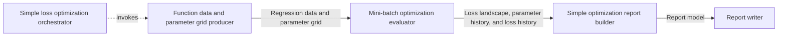
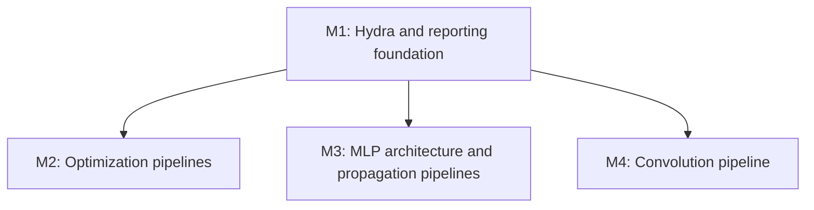

## SpbU Neural Networks constitution spec

### 1. Executive summary

#### 1.1. Project description

This project is a collection of neural network models, methods, studies, and experiments used in the Neural Networks course taught at SpbU. Each pipeline is runnable and Hydra-configured, and produces an HTML report with LaTeX support and, when needed, SVG/PNG figures in its configured run directory. These outcomes are intended for integration into `anton-pershin/getsomemath`.

#### 1.2. Project motivation

The project turns neural network concepts into executable examples that students and instructors can run, inspect, and discuss. Generating consistent reports and figures makes these examples easier to reuse in course materials and supports teaching and general understanding of neural networks.

#### 1.3. Implementation repos

- `anton-pershin/spbu-neural-networks-teacher` — the solution implementation repo; this repo is also the solution subproject's management repo.

#### 1.4. Architecture type

Pipeline architecture

#### 1.5. Execution mode

Manual

### 2. Requirement analysis

#### 2.1. Functional requirements

**FR1. Pipeline execution and report generation.** Each pipeline must be exposed as an executable script configured through Hydra. Running the script must produce an HTML report with LaTeX support in the Hydra-configured run directory.

**FR2. Figure generation.** A pipeline may generate figures needed by its report. Every generated figure must be written to the same Hydra-configured run directory as the report.

**FR3. Figure format selection.** A generated figure must be saved as SVG by default. If its SVG representation is larger than 100 KB, the pipeline must save the figure as PNG instead of SVG.

#### 2.2. Non-functional requirements

None.

#### 2.3. Preferences

**P1. Hydra-based project structure and configuration.** Follow the `hydra-repo` skill for repository layout, configuration, environment-specific settings, executable scripts, tests, documentation, and development workflow.

### 3. Acceptance criteria

No validation subproject is used. Acceptance combines automated checks with mandatory human review; no numerical model-performance thresholds are imposed.

**AC1. Pipeline outputs (FR1, FR2).** For each pipeline, run its executable script with a test Hydra configuration and verify that it completes successfully, creates an HTML report with LaTeX support in the configured run directory, and writes all generated figures to that directory.

**AC2. Figure format selection (FR3).** Automated tests must exercise figures on both sides of the 100 KB threshold and verify that a figure is saved as SVG when its SVG representation is at most 100 KB and as PNG instead of SVG otherwise. For this criterion, 100 KB means 102,400 bytes.

**AC3. Human review (FR1–FR3).** A human reviewer must open each pipeline's report, inspect its rendered content and figures for educational correctness and compliance with the output contract, and explicitly approve the pipeline. Passing automated checks alone is not sufficient for acceptance.

### 4. Overall solution design

#### 4.1. High-level design

Each executable script implements one pipeline with its own orchestrator. Solid arrows denote unidirectional, in-memory data pipes; dotted arrows denote filter invocation by an orchestrator. Numerical filters are independent of file output, and every pipeline terminates in the shared report writer.

**Simple convolution — `simple_convolution.py` orchestrator**

**Hidden norms propagation — `hidden_norms_propagation.py` orchestrator**

**Learning-rate schedulers — `schedulers.py` orchestrator**

**Balduzzi analysis — `balduzzi_analysis.py` orchestrator**

**Loss landscape — `loss_landscape.py` orchestrator**

**Simple loss optimization — `simple_loss_optimization.py` orchestrator**

**MLP width experiment — `mlp_width_experiment.py` orchestrator**

**MLP depth experiment — `mlp_depth_experiment.py` orchestrator**

#### 4.2. Core components

**Orchestrators and pipeline-specific filters.** Each orchestrator is a thin Hydra entry point at the path shown below. It resolves configuration, constructs the filters, connects their pipes, and invokes them in the order shown in section 4.1. It contains no numerical experiment, figure-rendering, or report-persistence logic.

| Orchestrator | Producer filter | Transformer filter(s) | Reducer filter |
|---|---|---|---|
| `spbunn/scripts/simple_convolution.py` | Load and normalize images; construct horizontal, vertical, and diagonal kernels | Apply repeated grouped convolutions | Convolution report builder |
| `spbunn/scripts/hidden_norms_propagation.py` | Generate random MLPs, inputs, output gradients, and perturbations | Measure hidden and gradient norms, empirical sensitivity, and Jacobian spectra across initialization, depth, and residual variants | Propagation diagnostics report builder |
| `spbunn/scripts/schedulers.py` | Create the epoch grid and scheduler settings | Evaluate linear, step, reduce-on-plateau, and cosine-annealing schedules | Scheduler report builder |
| `spbunn/scripts/balduzzi_analysis.py` | Construct plain and residual deep ReLU networks and an input grid | Compute gradients of summed network outputs with respect to inputs | Balduzzi analysis report builder |
| `spbunn/scripts/loss_landscape.py` | Sample function data; construct parameter grids and optimizer configurations | Evaluate MSE landscapes and full-batch trajectories for SGD variants, RMSprop, and Adam | Loss landscape report builder |
| `spbunn/scripts/simple_loss_optimization.py` | Sample function data and construct a parameter grid | Run mini-batch SGD and compute its loss landscape | Simple optimization report builder |
| `spbunn/scripts/mlp_width_experiment.py` | Generate function-regression datasets and width-sweep settings | Search hyperparameters; train shallow ReLU models across widths and seeds; collect predictions and errors | MLP width report builder |
| `spbunn/scripts/mlp_depth_experiment.py` | Generate function-regression datasets and depth-sweep settings | Search hyperparameters; train deep plain ReLU models across depths and seeds; collect predictions and errors | MLP depth report builder |

Producers only generate or load experiment input. Transformers only compute numerical results. Each report builder is a reducer that converts its pipeline's results into a report model containing HTML content, figure objects, and artifact names. Report builders may share presentation utilities but own their pipeline-specific explanatory content. Reusable model, training, and numerical utilities are explicit dependencies of producer and transformer filters; they do not write artifacts or own pipeline orchestration.

**Pipes.** Pipes are explicit, unidirectional arguments and return values between filters; filters do not communicate through global state or the run directory.

| Pipe | Contents |
|---|---|
| Experiment input | Pipeline-specific images, kernels, numerical grids, samples, training data, model settings, and hyperparameter grids |
| Experiment result | Numerical curves, transformed images, predictions, training histories, gradients, norms, Jacobian metrics, and optimization results |
| Report model | HTML content, figure objects, and artifact names required by the report |

**Shared report writer.** The report writer is the single consumer used by every pipeline. It writes the report model's HTML with LaTeX support and figures into the Hydra-configured run directory. For each figure, it serializes the SVG representation, saves SVG when its size is at most 102,400 bytes, and otherwise saves PNG instead of SVG. It performs no model fitting or other numerical experiment work.

**Configuration.** Hydra configurations provide pipeline parameters, random seeds, input paths, artifact names, and the run directory. Filters receive their dependencies and settings explicitly; environment-specific settings follow the `hydra-repo` layout.

### 5. Roadmap

| ID | Name | Status | Expected result |
|----|------|--------|-----------------|
| M1 | Hydra and reporting foundation | Done | The repository has the Hydra-based package, configuration, test, and documentation structure; shared report models and the report writer satisfy the run-directory and SVG/PNG output contract, with automated threshold tests. |
| M2 | Optimization pipelines | Done | `schedulers.py`, `loss_landscape.py`, and `simple_loss_optimization.py` run as Hydra-configured pipelines and produce complete HTML reports and figures through the shared components. |
| M3 | MLP architecture and propagation pipelines | Done | `mlp_width_experiment.py`, `mlp_depth_experiment.py`, `hidden_norms_propagation.py`, and `balduzzi_analysis.py` run as Hydra-configured pipelines and produce complete HTML reports and figures through the shared components. |
| M4 | Convolution pipeline | Done | `simple_convolution.py` runs as a Hydra-configured pipeline and produces a complete HTML report and figures through the shared components. |

M2, M3, and M4 may proceed concurrently after M1.

