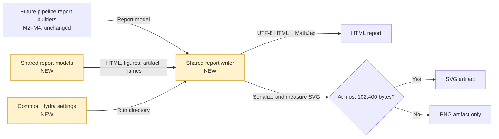
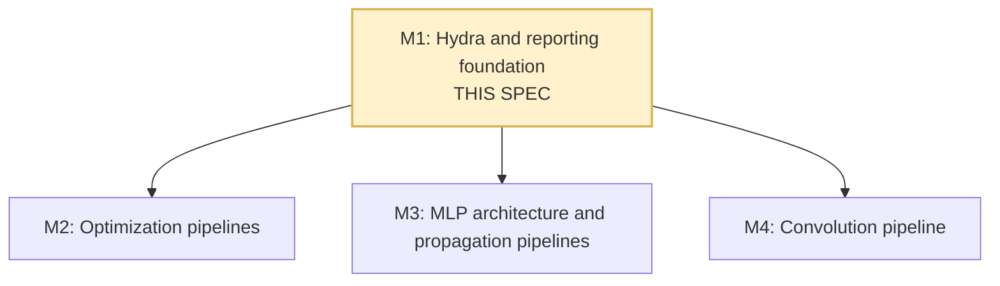

## M1 Hydra and reporting foundation

### 1. Executive summary

#### 1.1 Spec description

Implement the repository foundation required by roadmap item M1. Add the standard Hydra project metadata, common configuration groups, package and test structure, developer commands, and documentation. Add shared report models and a report writer that writes a complete HTML document with LaTeX support and writes each Matplotlib figure as SVG or PNG in the configured run directory.

#### 1.2 Spec motivation

M2, M3, and M4 depend on a common project structure and output implementation. A shared foundation prevents pipeline-specific output rules and gives those milestones a tested interface for report generation.

#### 1.3 Implementation repos

- `anton-pershin/spbu-neural-networks-teacher` — solution implementation and management repo.

### 2. Requirement analysis

#### 2.1 Functional requirements

**FR1. Hydra repository foundation.** Follow the `hydra-repo` layout for Python packaging, runtime and development dependencies, common Hydra settings, executable-script support utilities, tests, documentation, and developer checks. Preserve the existing experiment implementations and their pipeline-specific configuration files.

**FR2. Common run-directory configuration.** Provide reusable Hydra settings for the run directory and job logging. Use an environment variable with a documented local default for the user-specific Hydra root. Provide a utility that returns the repository configuration path to Hydra entry points.

**FR3. Shared report models.** Represent a report with HTML content, an HTML artifact name, a title, and zero or more figures. Represent each figure with its Matplotlib figure object and an artifact-name stem. The models must not perform file output.

**FR4. HTML report output.** The report writer must receive the run directory explicitly, create it when necessary, and write a UTF-8 HTML artifact there. The generated document must include the report content, its figures, and MathJax support for LaTeX notation.

**FR5. Figure format selection.** For each figure, serialize its SVG representation and measure its size in bytes. Write the SVG artifact when the size is at most 102,400 bytes. Write a PNG artifact instead when the size is greater than 102,400 bytes. Use the figure model's artifact-name stem and write no figure artifact outside the run directory.

**FR6. Foundation documentation.** Document environment setup, the repository structure, common Hydra settings, report-model construction, report-writer use, output naming, the size threshold, tests, and developer checks.

**FR7. Milestone boundary.** Do not migrate the legacy scripts in `spbunn/scripts/` into the pipeline architecture in this spec. Do not add numerical experiment behavior or a new course pipeline.

#### 2.2 Non-functional requirements

**NFR1. Component isolation.** Keep report models, HTML generation, and figure persistence independent of numerical experiment code. Pass dependencies and settings explicitly; do not use global output state.

**NFR2. Deterministic automated checks.** Use isolated temporary directories and deterministic SVG byte sequences for boundary tests. Test below, at, and above the 102,400-byte threshold without network access.

**NFR3. Defensive artifact handling.** Reject empty artifact names, path-containing artifact names, duplicate figure artifact-name stems, and collisions between the HTML artifact name and either possible figure artifact name before writing. Ensure that rerunning a report with the same figure stem does not leave both SVG and PNG artifacts.

**NFR4. Focused quality checks.** Format, lint, type-check, and test the new foundation code without reformatting or otherwise changing unrelated legacy experiment code.

### 3. Acceptance criteria

**AC1. Repository foundation (FR1, FR2, FR6).** Automated tests must locate the repository configuration directory and compose the common Hydra run-directory settings with a test configuration. Project metadata, dependency files, developer commands, tests, and documentation must exist and describe the implemented behavior.

**AC2. HTML output (FR3, FR4).** An automated test must write a report into a new nested temporary run directory and verify that the configured HTML artifact exists there. Its contents must include the supplied report body, the figure reference when a figure is present, and MathJax LaTeX support.

**AC3. SVG boundary (FR5).** Automated tests must use SVG representations of 102,399 and 102,400 bytes and verify that only the expected SVG artifact is written in each case.

**AC4. PNG fallback (FR5).** An automated test must use an SVG representation of 102,401 bytes and verify that only the expected PNG artifact is written. A second test must verify removal of a stale artifact with the alternative extension.

**AC5. Artifact validation (FR3–FR5, NFR3).** Automated tests must reject unsafe, duplicate, and colliding artifact names and must confirm that multiple figures and the HTML report are written to the same run directory.

**AC6. Quality and scope (NFR1–NFR4, FR7).** The complete test suite and the documented developer checks must pass. A diff review must confirm that legacy numerical behavior is unchanged and that no M2–M4 pipeline migration is included.

**AC7. Human review.** A human reviewer must inspect the report-writer interface and a generated report for correct HTML content, LaTeX support, and figure presentation. Human review remains necessary; automated checks alone do not establish acceptance.

### 4. High-level solution design

M1 creates the shared foundation shown below. Later milestones will connect pipeline-specific report builders to the report writer. No existing orchestrator or numerical filter changes in this spec.

The roadmap dependency remains unchanged; M1 is the component implemented here.

At component level, `ReportModel` contains immutable figure entries and document metadata. `ReportWriter` validates artifact names, serializes and stores figures, inserts their final file names into the generated HTML, and writes the HTML artifact. It returns the HTML artifact path for callers and tests. Matplotlib figures remain owned by the caller; the writer does not close them or perform experiment work.
