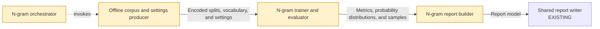

## N-gram language-model pipeline

### 1. Executive summary

#### 1.1 Spec description

Implement roadmap item M5 as one word-level n-gram language-model pipeline. Train unigram, bigram, and trigram count models on an offline, hash-checked Alice corpus obtained from the official NLTK Gutenberg distribution. Produce an HTML report that explains probabilistic language modelling through conditional probabilities, held-out perplexity, sparsity, and seeded text generation. Preserve the producer / transformer / report-builder / shared-report-writer architecture.

The selected teaching example and its evidence are recorded in the [n-gram pipeline investigation](../investigations/ngram-pipeline.md).

#### 1.2 Spec motivation

GetSomeMath introduces n-grams as simple language models but provides no executable example of their predictions or performance. Students need to see both the benefit of local context and the effects of zero counts, smoothing, limited context, and overfitting. A reproducible report with explicit probability distributions and unedited samples makes those concepts inspectable.

#### 1.3 Implementation repos

- `anton-pershin/spbu-neural-networks-teacher` — solution implementation and management repo.

### 2. Requirement analysis

#### 2.1 Functional requirements

**FR1. Offline corpus and provenance.** Vendor the unchanged `gutenberg/carroll-alice.txt` file from official NLTK data commit `550b6625bcef1f2abff2ff770a5a0d272c9c6b2a`. Record the pinned archive URL, archive SHA-256 `2d3c3ab548c653944310f37f536443ec85d0a0ad855fcae217a0c9efdce2d611`, extracted-file SHA-256 `5ce9042c0d8536b072b61d4c7c4e6d70c72d9dbb5f3d816261326d9280749266`, retrieval date, public-domain metadata, and original corpus notices. Load the resource through package APIs and verify its file hash before use. Do not install NLTK, invoke `nltk.download()`, or access the network during a pipeline run.

**FR2. Deterministic preprocessing and splitting.** Remove the one-line NLTK bracketed title header. Lowercase words, retain internal apostrophes and hyphens, treat `.`, `!`, and `?` as sentence boundaries, protect `Mr`, `Mrs`, `Ms`, `Dr`, and `St` abbreviations from boundary splitting, and discard sentences shorter than three words. Shuffle sentence indices with seed 42 and split by sentence using training, validation, and test fractions 0.70, 0.15, and 0.15, with rounded cumulative boundaries. Build the vocabulary from training tokens only, mapping tokens below configured minimum count 2 to `<unk>`. Use `<bos>` only as left context and append `<eos>` to every encoded sentence. The production corpus must yield 1,503 retained sentences, splits of 1,052 / 226 / 225 sentences, and a prediction vocabulary of 1,163 tokens including `<unk>` and `<eos>` but excluding `<bos>`.

**FR3. Count models, smoothing, and evaluation.** For each configured order 1, 2, and 3, count exact n-grams and contexts in the encoded training data. For context `c`, next token `w`, vocabulary size `|V|`, and positive alpha, compute `P(w|c) = (count(c,w) + alpha) / (count(c) + alpha * |V|)`. An unseen context must give a uniform distribution. Select alpha independently for each order from `(0.001, 0.003, 0.01, 0.03, 0.1, 0.3, 1.0)` by minimum validation perplexity, resolving an exact tie by the earlier configured value. Calculate perplexity as `exp(-mean(natural_log_probability))`, including `<eos>` events. Evaluate training and test data with the selected alpha. Measure unseen n-gram event and unseen context fractions on each evaluated split, with zero unseen-context fraction for unigrams. The test set must not influence alpha selection.

**FR4. Top-k probabilities and generation.** For configured unigram, bigram-after-`the`, and trigram-after-`of-the` queries, return the five highest-probability next tokens with counts and selected-alpha smoothed probabilities. Order by descending probability and then token text for deterministic ties. Include the exact remaining probability mass so each displayed distribution sums to one before rounding. Generate samples for every order and each configured seed 7, 42, and 123 by sampling from the full smoothed vocabulary, shifting the context after each token, and stopping at `<eos>` or 30 generated tokens. Retain empty and poor samples and record the stop reason. Do not truncate generation to top-k or edit generated wording.

**FR5. Hydra pipeline and filter boundaries.** Expose `python -m spbunn.scripts.ngram` with production and test Hydra configurations composed from the common run-directory and logging settings. Put the corpus resource/hash, split settings, minimum count, orders, alpha grid, probability queries, top-k value, generation settings, and report names in configuration. A producer must return typed experiment input. A transformer must fit models and return typed results without Hydra, Matplotlib, or artifact output. The orchestrator must only connect filters, invoke the shared writer, and close figures on success and failure.

**FR6. Educational report.** Build `ngram.html` through the existing `ReportModel` and shared `ReportWriter`. Include the model equation, source/provenance, preprocessing and split rules, corpus statistics, selected alphas, observed type/context counts, training/validation/test perplexities, sparsity metrics, top-k tables, all generated samples, and stop reasons. Explain sampling and the distinction between local patterns and global meaning. State that the observed order comparison is specific to this corpus and split, not a universal ranking. Include figures with stems `ngram_validation_perplexity`, `ngram_train_test_perplexity`, `ngram_test_sparsity`, and `ngram_top_k_probabilities`. Escape all source text, tokens, contexts, and generated samples before inserting them into trusted HTML.

**FR7. Documentation and checks.** Document execution, configuration, corpus provenance, numerical definitions, outputs, figure names, example observations, and tests in `docs/ngram.md` and the README. Include the new numerical modules, orchestrator, report builder, and tests in focused formatting, lint, type, and test checks. Preserve all existing behavior and checks.

**FR8. Approved milestone boundary.** Add only the M5 n-gram pipeline and its supporting SDD records, resources, configuration, documentation, and tests. Apply the approved constitution additions for the n-gram design and M5 roadmap item and the approved terminology additions. Do not change FR1–FR3 or AC1–AC3 of the constitution, the shared report-writer contract, unrelated legacy modules, GetSomeMath, or another repository. Do not add backoff, interpolation, neural models, model serialization, a runtime downloader, or a generic pipeline framework.

#### 2.2 Non-functional requirements

**NFR1. Reproducibility and offline operation.** Use only explicit local random generators and the vendored corpus. Identical inputs and settings must give identical splits, selected alphas, probability rows, metrics, and samples. Record source hashes and avoid dependence on global random state, an NLTK installation, or an `nltk_data` directory.

**NFR2. Numerical correctness and scope.** Use positive finite smoothing values and natural logarithms. Normalize over the full prediction vocabulary. Do not impose a model-performance threshold. Production metric regression checks may detect unintended source or preprocessing changes but must not certify general language-model quality.

**NFR3. Validation and resource safety.** Reject invalid corpus headers/hashes, empty or duplicate orders, non-positive orders, invalid split fractions or empty splits, non-positive minimum counts, empty or invalid alpha grids, non-positive top-k values, invalid generation seeds/limits, and queries with an unconfigured order or wrong context length. Integer-valued settings must be finite and integral before conversion; never silently truncate fractional values. Use clear errors. Keep artifact names safe and close all figures after writer success or failure.

**NFR4. Separation and focused maintenance.** Producers only load, validate, preprocess, and type experiment input. Transformers only compute numerical results. Builders only create escaped presentation and figures. Use small dataclasses and functions, standard-library numerical/text operations, and existing plotting/reporting dependencies. Do not write artifacts from numerical filters or reformat unrelated modules.

### 3. Acceptance criteria

**AC1. Corpus and preprocessing (FR1, FR2, NFR1, NFR3).** Tests must verify the exact vendored SHA-256, package-resource access, header handling, tokenization, abbreviation protection, minimum sentence length, deterministic split, disjoint sentence indices, training-only vocabulary, special-token handling, and the production corpus counts in FR2. Tests must cover invalid resources and preprocessing settings.

**AC2. Model and evaluation correctness (FR3, NFR2).** Hand-calculated tiny-corpus tests must cover n-gram/context counts, context padding, unknown tokens, add-alpha probabilities, normalization for seen and unseen contexts, perplexity including `<eos>`, sparsity fractions, validation-only alpha selection, and configured tie-breaking. Production regression tests must identify the investigated selected alphas and metrics without using them as pass/fail performance thresholds.

**AC3. Probability displays and generation (FR4, FR6).** Tests must independently verify top-k counts, probabilities, ordering, tie-breaking, and remaining mass. Tests must prove deterministic full-vocabulary generation, context shifting, empty samples, both stop reasons, and maximum-length enforcement. Builder tests must verify that every configured sample and all top-k tables appear with escaped dynamic content.

**AC4. Pipeline and report outputs (FR5, FR6, NFR3, NFR4).** Compose both configurations and run the executable test pipeline in a subprocess from a different working directory. Verify the configured HTML, four referenced figures, SVG/PNG exclusivity, all artifacts in the run directory, no working-directory figures, embedded MathJax, and no external script. Verify orchestrator figure cleanup after success and controlled writer failure.

**AC5. Quality and approved scope (FR7, FR8).** The complete test suite, focused static checks, and package build must pass. Package inspection must include the corpus and provenance resources. A diff review must confirm the approved M5/terminology changes and no unrelated pipeline or shared-writer changes.

**AC6. Human educational review.** A human reviewer must open the production report, inspect equations, top-k probabilities, metrics, figures, and all samples, and explicitly approve its mathematical and educational correctness. At least one report must be opened with network access disabled. Automated checks alone do not establish acceptance.

### 4. High-level solution design

M5 adds the following constitution flow. Yellow components are new; the report writer and report models are existing shared components.

**N-gram language model — `ngram.py` orchestrator**

`spbunn.ngram` owns typed settings, corpus products, count models, evaluation results, top-k distributions, and generated samples. The producer converts and validates Hydra settings, loads and hash-checks package bytes, and constructs disjoint raw splits and the training vocabulary. The transformer encodes splits, fits each order, selects smoothing on validation data, evaluates metrics, calculates probability displays, and generates samples. It returns no model or report artifact and performs no file output.

`spbunn.reporting.ngram` converts results into explanatory HTML, tables, and four Matplotlib figures. `spbunn.scripts.ngram` contains only Hydra entry-point orchestration and figure cleanup. Packaged resources under `spbunn.data` contain the unchanged corpus and its provenance. Production and test configurations share the same data flow; the test configuration reduces only generation output while retaining the real offline resource and all four figures.
