## BPE pipeline

### 1. Executive summary

#### 1.1 Spec description

Implement roadmap item M5 as one Hydra-configured BPE pipeline with a two-part HTML report. The first part uses the standard `low`, `lower`, `newest`, and `widest` example to expose every merge and corpus change. The second part trains the same character-initialized BPE algorithm on a bundled public-domain copy of *Alice's Adventures in Wonderland* and evaluates selected merge checkpoints on held-out chapters. The report must show both how tokens are synthesized and how a larger learned vocabulary reduces text length.

#### 1.2 Spec motivation

The GetSomeMath sequence-modelling notes introduce BPE without an executable demonstration. A complete small trace makes token synthesis visible, while a real corpus demonstrates the reduction in token count and the reuse of learned words and fragments on unseen text. The two parts separate algorithm understanding from corpus-scale behavior without introducing tokenizer-library abstractions.

#### 1.3 Implementation repos

- `anton-pershin/spbu-neural-networks-teacher` — solution implementation and management repo.

### 2. Requirement analysis

#### 2.1 Functional requirements

**FR1. Hydra entry point and configuration.** Expose `spbunn/scripts/bpe.py` through `python -m spbunn.scripts.bpe`. Compose the common M1 run-directory and logging settings in `config/config_bpe.yaml` and supply `config/config_test_bpe.yaml`. Put both experiments, corpus path, merge counts, checkpoints, sample texts, report title, and artifact names in configuration. Each run must create `bpe.html` by default and all figures through the shared report writer in `result_dir`.

**FR2. Character-initialized BPE.** Represent each training word as Unicode characters followed by the end-of-word marker `</w>`. Count adjacent pairs using the configured word frequencies. At each step select a pair with maximum weighted frequency, breaking ties by lexicographic order of the first and then second token. Replace all non-overlapping occurrences from left to right and record the ordered merge rule. Stop after the configured merge count or earlier if no adjacent pair remains. This is not UTF-8 byte-level BPE.

**FR3. Complete toy demonstration.** Use ordered frequencies `low: 5`, `lower: 2`, `newest: 6`, and `widest: 3`, with 12 requested merges. Show the initial vocabulary and corpus, every selected pair and frequency, every new token, and the complete post-merge corpus. Show vocabulary size and weighted corpus token count at step zero and after every merge. Tokenize `low lower newest lowest widest wide`; in particular, show how the unseen word `lowest` reuses learned tokens.

**FR4. Bundled larger corpus.** Bundle the complete public-domain Project Gutenberg text of *Alice's Adventures in Wonderland* with source and license information under `data/`. Load it without network access. Normalize curly apostrophes, lowercase the text, and extract words containing ASCII letters and internal apostrophes. Exclude chapter headings and titles, including the differently formatted Chapter XII title. Train on chapters 1–10 and hold out chapters 11–12 for evaluation. Keep word frequencies instead of expanding repeated words into separate corpus entries. Document the preprocessing and split.

**FR5. Large-corpus training and checkpoints.** Request 1,000 merges in the production configuration. Do not retain or print every large-corpus state. Record aggregate vocabulary sizes and weighted training-token counts for all steps, but retain detailed evaluation only for configured checkpoints `0`, `100`, `250`, `500`, and `1000`. Checkpoints must begin with the zero-merge character baseline so every reported reduction has a fixed reference. Each checkpoint must use the corresponding prefix of the single learned merge sequence; do not retrain a model for each checkpoint.

**FR6. Held-out evaluation.** At each checkpoint, tokenize all held-out words and record vocabulary size, training-token count, held-out token count, and mean held-out tokens per word. Compare these values with character tokenization at step zero. Show a compression figure and a checkpoint table. Tokenize the configured held-out sentence `the knave of hearts he stole those tarts and took them quite away` at every checkpoint. Show frequent learned tokens with their weighted training frequencies and several held-out words absent from training, including their learned tokenizations.

**FR7. Report construction.** Build one report with explanatory HTML and LaTeX, a compact token-block view of the complete toy trace, the larger-corpus results, and clear limitations. Use configurable figure artifact names with defaults `bpe_toy_dynamics` and `bpe_large_corpus_compression`. State that fewer tokens do not by themselves prove better language-model quality. Escape all corpus, token, and configurable text. Send the report model to the existing shared writer and do not duplicate persistence, MathJax, or figure-format logic.

**FR8. Documentation and developer checks.** Document the execution command, two report sections, corpus source and preprocessing, configuration, output names, deterministic tie-breaking, unknown-character behavior, and tests in the README and `docs/bpe.md`. Add the new modules to focused formatting, lint, and type checks. Update the constitution's M5 design and the approved BPE terminology.

**FR9. Scope boundary.** Add only the BPE pipeline, its bundled corpus, tests, documentation, spec, and approved constitution and terminology changes. Do not add an n-gram pipeline, UTF-8 byte-level BPE, pretrained tokenizer integration, a generic tokenizer framework, a validation subproject, or GetSomeMath changes. Do not change the shared report-writer contract or unrelated numerical pipelines.

#### 2.2 Non-functional requirements

**NFR1. Filter isolation.** Producers only load and validate experiment input. Transformers only train BPE, tokenize text, and calculate metrics. Report builders own presentation. The orchestrator only connects explicit inputs and results, invokes the shared writer, and releases figures. Training and tokenization must not depend on Hydra, Matplotlib, or file output.

**NFR2. Deterministic behavior.** Use no random state. Preserve configured word order, merge ranks, checkpoint order, and sample order. Apply the specified frequency and lexicographic tie rules in every run. All results must be reproducible without network access.

**NFR3. Input and resource safety.** Reject empty corpora, empty words, words containing whitespace, non-positive frequencies, negative merge counts, invalid checkpoints, missing corpus sections, and unknown sample characters with clear errors. Keep full post-merge corpora only for the toy experiment. Use safe unique artifact names, escape HTML, and close figures after successful writes and writer failures.

**NFR4. Reproducible and isolated checks.** Use temporary run directories, small test merge counts, a headless Matplotlib backend, and no downloads. Tests must not leave artifacts in the working directory or depend on timestamped output discovery. The complete production corpus must be available in source checkouts and source distributions.

**NFR5. Focused maintenance.** Use small typed data objects and pure functions. Reuse report models and the writer. Add no runtime dependency and do not modify unrelated optimization, MLP, or convolution behavior.

### 3. Acceptance criteria

**AC1. Configuration and execution (FR1, FR7, NFR4).** Tests must compose production and test configurations. A subprocess run with the test configuration and an explicit temporary run directory must create the configured HTML artifact and both referenced figures in that directory. The HTML must contain embedded MathJax and no external script. Exactly one SVG or PNG artifact must exist per figure stem, with no figure in the working directory.

**AC2. BPE correctness (FR2, FR3, NFR2, NFR3).** Hand-calculated tests must verify weighted counts, lexicographic tie-breaking, non-overlapping left-to-right replacement, deterministic vocabulary ordering, and early termination. The toy corpus must start with 11 vocabulary tokens and weighted token count 95, including end-of-word markers. Its first three merges must be `(e, s) -> es`, `(es, t) -> est`, and `(est, </w>) -> est</w>`, each with frequency 9. After 12 merges it must have 23 vocabulary tokens and weighted token count 22. Merging `(a, a)` in `aaa` must produce `(aa, a)`, not `aaa`.

**AC3. Tokenization correctness (FR2, FR3, FR6).** Tests must apply an independent merge sequence in rank order and verify word boundaries, unknown-character errors, and unchanged word content after token concatenation and removal of `</w>`. With the 12 toy merges, `lowest` must tokenize as `low` and `est</w>`. Prefix tokenization at every checkpoint must equal tokenization with a separately trained model stopped at that checkpoint.

**AC4. Larger-corpus data and evaluation (FR4–FR6, NFR2).** Tests must verify corpus extraction, chapter splitting, word normalization, nonempty training and held-out sets, and actual chapter ranges 1–10 and 11–12. Small-fixture tests must independently verify held-out counts, means, checkpoint order, training counts, and frequent-token ranking. The production run must reach 1,000 merges, produce fewer held-out tokens than its character baseline, and show held-out tokenization at every configured checkpoint. Tests must verify that claimed unseen words do not occur in training.

**AC5. Trace and report completeness (FR3, FR5–FR7).** Builder tests must verify every toy merge and post-merge corpus, exact toy metric series, all configured large checkpoints, sentence tokenizations, frequent learned tokens, unseen-word examples, explanatory LaTeX, and the limitation statement. They must verify figure x-values and y-values, stable unique stems, and escaped literal `</w>` and configurable HTML text.

**AC6. Shared reporting and resources (FR7, NFR1, NFR3).** Existing writer tests must continue to verify the 102,400-byte SVG/PNG threshold and stale-format removal. New orchestrator tests must verify figure cleanup after success and writer failure. Training and tokenization must have no file-output or plotting dependency.

**AC7. Quality and scope (FR8, FR9, NFR1–NFR5).** The complete test suite, focused static checks, and package build must pass. The source distribution must contain the bundled corpus and its source information. A diff review must confirm only the approved BPE and supporting documentation changes, no new runtime dependency, and no shared-writer contract change.

**AC8. Human educational review.** A human reviewer must open the generated report, check both teaching sections, merge traces, equations, checkpoint tokenizations, figures, and output files for educational correctness, and explicitly approve the pipeline. At least one report must be opened with network access disabled to confirm that LaTeX and figures remain usable.

### 4. High-level solution design

M5 adds the following flow to the constitution. Yellow components are new; report models and the writer are existing M1 components.

```mermaid
flowchart LR
  O["BPE orchestrator"] -. invokes .-> P["Toy and book corpus producer"]
  P -- "Word frequencies, merge settings, held-out words, and samples" --> T["BPE trainer, tokenizer, and checkpoint evaluator"]
  T -- "Toy trace, merge rules, checkpoint metrics, and tokenizations" --> B["Two-part BPE report builder"]
  B -- "Report model" --> C["Shared report writer<br/>EXISTING"]
  classDef current fill:#fff2cc,stroke:#d6b656,stroke-width:2px;
  class O,P,T,B current;
```

At component level, `spbunn.sequence.bpe` contains typed corpus, merge, training, checkpoint, and tokenization objects and pure BPE calculations. `spbunn.sequence.pipeline` validates Hydra settings, loads the bundled book, constructs the toy and large experiments, and invokes the numerical filters. `spbunn.reporting.bpe` builds token-block tables, explanatory HTML, checkpoint tables, and two Matplotlib figures without serializing them. `spbunn.scripts.bpe` contains only Hydra setup, orchestration, shared-writer invocation, and figure cleanup.

The production configuration retains the full toy trace but only aggregate large-corpus series and selected checkpoints. Dedicated test configuration reduces merge counts while using the same data flow and bundled book. The raw Project Gutenberg file and its source information live under `data/`, with packaging configuration that includes them in source distributions. No new generic framework is introduced.
