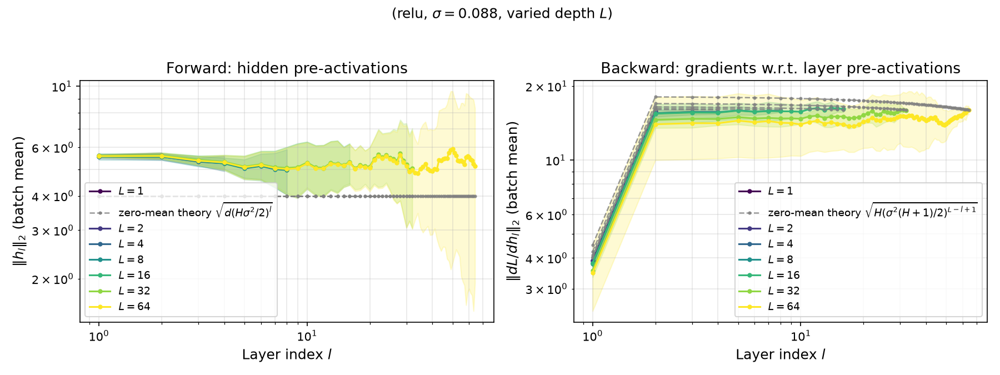
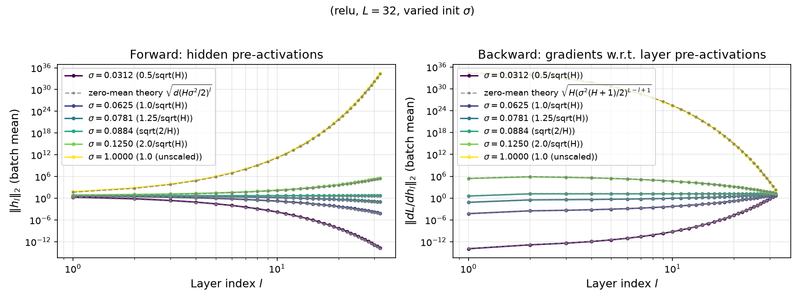
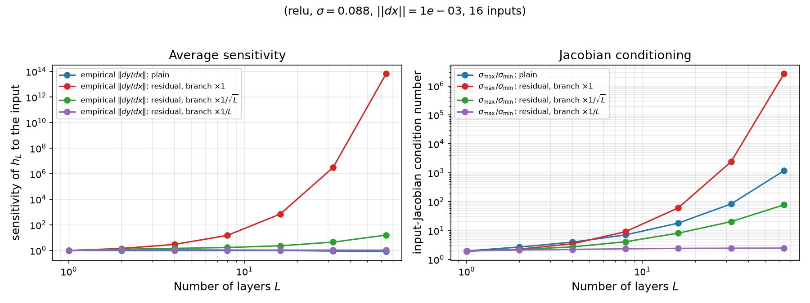

# Signal and Gradient Propagation in a Randomly Initialized MLP

Script: `spbunn/scripts/hidden_norms_propagation.py` · Config: `config/config_hidden_norms.yaml`
Run: `~/venvs/spbu_nn/bin/python -m spbunn.scripts.hidden_norms_propagation`

## 1. Setup

We study a fully-connected MLP with $L$ hidden layers of width $H$, zero biases, and
weights sampled independently $W_{ij} \sim \mathcal{N}(0, \sigma^2)$. Every hidden block is

$$h_l = \mathrm{ReLU}(W_l\, h_{l-1}), \qquad l = 1, \dots, L,$$

with $h_0 = x \in \mathbb{R}^d$ the input. We record what happens in a **single forward and
backward pass at initialization** — no training. All experiments use `float64` (the exploding
regimes overflow `float32` at moderate depths) and average over several random
initializations (seeds), plotting mean $\pm$ std bands.

**Random inputs and random labels.** Inputs are iid $x_i \sim \mathcal{N}(0, 1)$,
$d = 16$, batch 256. The backward pass is probed with an isotropic random output gradient
$g \sim \mathcal{N}(0, I)$, which is equivalent to fitting independent random labels:
at initialization $f(x) \approx 0$, so the initial error $\delta = y - f(x) \approx y$ is
itself isotropic noise. The point: the backward norms then measure the *Jacobian chain
itself*, not a particular target function. For a structured target the initial error could
accidentally be small or aligned with a particular direction of the Jacobian, confounding
the depth dependence we want to isolate. This is the standard probe of the signal
propagation literature (Poole et al. 2016, Schoenholz et al. 2017). Since inputs are
distributional, nothing restricts us to $d = 1$: with $d > 1$ the batch is isotropic from
layer 0 on.

**Theory (zero-mean approximation).** For ReLU with zero biases, the pre-activations are
approximately zero-mean Gaussian, and

$$\mathbb{E}\|h_l\|^2 \;=\; d\,\Big(\frac{H\sigma^2}{2}\Big)^{l}, 
\qquad 
\mathbb{E}\left\|\frac{\partial \mathcal{L}}{\partial h_l}\right\|^2 \;=\; 
H\,\Big(\frac{\sigma^2 (H+1)}{2}\Big)^{L-l+1}
\quad (l \ge 2),$$

up to corrections. The *forward* per-layer factor is $q = H\sigma^2/2$ (exactly, in
expectation); the *backward* factor carries the $+1$ finite-width correction from the
weight-gradient term. Note the backward signal compounds over the **remaining** layers
$(L - l)$, hence its much steeper depth dependence than the forward curve. The Kaiming
scale

$$\sigma^2 = \frac{2}{H} \quad\Longleftrightarrow\quad q = 1$$

makes the forward factor exactly $1$: the critical initialization. These closed forms are
**zero-mean approximations**: ReLU outputs have positive means, and near criticality the
accumulated mean shift moves the empirical fixed point slightly above the prediction
(forward curves settle a bit above $\sqrt{d}$ instead of exactly $\sqrt{d}$). In the
decay/explode regimes the theory matches over many orders of magnitude regardless.

Defaults below: $H = 256$, $d = 16$, batch 256, 5 seeds, ReLU.

## 2. Experiment 1: forward and backward norms vs depth (figure `hidden_norms_depth_relu`)

Fix $\sigma = \sqrt{2/H}$ (critical) and vary $L \in \{1, 2, 4, 8, 16, 32, 64\}$.

**Q1 — how does $\|h_l\|_2$ depend on the layer location and total depth?**
It does not — that is the point. Every curve is flat at $\approx \sqrt{d}$–$6$ across all
$l$ and all $L$: with the critical scale the multiplicative process is neutral, so depth
alone neither amplifies nor attenuates the signal. Depth only decides *how far* the
(neutrally stable) process runs.

**Q2 — how does $\|\partial\mathcal{L}/\partial h_l\|_2$ depend on them?**
The mirror image, and quantitatively much more violent in relative terms: the gradient at
layer $l$ is a product of $L - l$ Jacobians, so it compounds over the *remaining* depth.
At criticality it stays $O(1)$, but any deviation of the per-layer factor from $1$ is
amplified exponentially in $L - l$ — this asymmetry is why gradients are so much more
fragile than activations.

**Q3 — dependence on the initialization distribution (figure `hidden_norms_init_relu`).**

Fix $L = 32$ and vary $\sigma$ around the critical value. With the per-layer factor
$q = H\sigma^2/2$:

| $\sigma$ | $q$ | forward $\|h_l\|$ | backward $\|d\mathcal{L}/dh_l\|$ |
|---|---|---|---|
| $0.5/\sqrt{H}$ | $0.125$ | decays to $\sim 10^{-13}$ | vanishes to $\sim 10^{-11}$ |
| $1/\sqrt{H}$ | $0.5$ | slow decay | slow decay |
| $\sqrt{2/H}$ | $1$ (critical) | flat | flat |
| $2/\sqrt{H}$ | $2$ | grows to $\sim 10^{6}$ | explodes to $\sim 10^{5}$ |
| $1$ (unscaled) | $128$ | explodes to $\sim 10^{34}$ | explodes correspondingly |

Both curves are exponential in $l$ with rate $q$ (forward) and rate determined by the
backward factor (backward); the dashed zero-mean theory lines track the measurements over
more than 30 orders of magnitude. One subtlety visible in the backward panel: at $l = 1$
the gradient contracts from $H$ dimensions into the $d$-dimensional input space, replacing
the last factor by $\sigma^2 d / 2$ — hence the characteristic dip of the first point.

## 3. Experiment 2: conditioning vs depth (figure `hidden_norms_conditioning_relu`)

**Claim:** even at the critical scale, depth makes the input–output map increasingly
*ill-conditioned* — not in the average, but in the spectrum.

**Design.** For each of 16 random inputs $x$ we compute two things:

1. *Empirical sensitivity* (the finite-difference probe): sample random directions
   $\|dx\| = 10^{-3}$ and measure
   $$S(x, dx) = \frac{\|f(x + dx) - f(x)\|_2}{\|dx\|_2},$$
   averaged over directions and inputs.
2. *The exact input Jacobian* $J = \partial h_L / \partial x \in \mathbb{R}^{H \times d}$
   via autograd, and its singular values $\sigma_{\max} \ge \dots \ge \sigma_{\min}$:
   the condition number $\kappa = \sigma_{\max}/\sigma_{\min}$ and the Frobenius norm
   $\|J\|_F$ (which equals the RMS sensitivity over all directions).

**Result (plain network, blue curves).** The average sensitivity is a red herring:
$\|dy/dx\|$ and $\|J\|_F/\sqrt{d}$ both stay $\approx 1$ for all $L$ — exactly the
criticality of Experiment 1. But the *spectrum spreads exponentially*:

$$\sigma_{\max}: 1.3 \to 3.2, \qquad 
\sigma_{\min}: 0.67 \to 3.2\times 10^{-3}, \qquad 
\kappa: 2 \to 1.2 \times 10^{3} \quad (L = 1 \to 64).$$

A product of many random matrices has singular values spanning an exponentially wide
range even when the typical gain is $1$. The map becomes hypersensitive to a few input
directions and nearly blind to most — this anisotropy (not the average norm) is the
mechanism behind shattered gradients. **Ill-conditioning hides from averages and shows
up in the spectrum.**

## 4. Experiment 3: do residual connections fix it?

We add skip connections, $h_l = h_{l-1} + s\cdot \mathrm{ReLU}(W_l h_{l-1})$ (the first,
$d \to H$ block stays plain, as the ResNet stem does), and rerun the conditioning
experiment for three choices of the branch scale $s$:

| variant | sensitivity $\|dy/dx\|$ ($L=1 \to 64$) | $\kappa$ ($L=1 \to 64$) | verdict |
|---|---|---|---|
| plain | $1.0 \to 0.86$ | $2 \to 1.2\times 10^{3}$ | ill-conditioned |
| $s = 1$ (naive) | $1.0 \to 1.3\times 10^{13}$ | $2 \to 2.6\times 10^{6}$ | **explodes** |
| $s = 1/\sqrt{L}$ (ResNet-style) | $1.0 \to 16$ | $2 \to 78$ | mild drift |
| $s = 1/L$ | $1.0 \to 1.05$ | $2 \to 2.5$ | **fixed** |

The intuition, block by block: with a skip, the block Jacobian is
$I + s \cdot \mathrm{diag}(\text{mask})\, W$, whose variance gain is roughly
$1 + s^2 H\sigma^2/2$. So:

- **$s = 1$ multiplies the signal variance by $1.5$ per block** — skip connections alone
  do *not* stabilize anything; they make a Kaiming-initialized network explode.
- **$s = 1/\sqrt{L}$** is the standard pre-activation ResNet initialization; it slows the
  drift but does not eliminate it.
- **$s = 1/L$** makes every block a vanishing perturbation of the identity, so the whole
  map is near-isometric for any depth — perfect conditioning by construction. The price:
  at initialization the network is close to the identity map (the "ResNets at init are
  almost the identity" observation of Balduzzi et al. 2017), i.e. the blocks barely
  contribute; training dynamics may prefer the $1/\sqrt{L}$ trade-off.

**Takeaway:** residual connections fix ill-conditioning *only* when the branch is scaled
so that blocks are perturbative ($s \propto 1/L$); naive skip connections at the Kaiming
scale make things worse.

## 5. Reproducing

All experiment parameters live in `config/config_hidden_norms.yaml`
(`input_dim`, `hidden_dim`, `depth_grid`, `weight_scale`, init-sweep scales,
conditioning counts; `experiments:` selects which of the three to run). The conditioning
experiment is the slow one (~20 min: $4$ variants $\times$ 7 depths $\times$ 5 seeds of
full-Jacobian SVDs).

Figures are saved as `.svg` (repo convention) and `.png` (messenger-friendly) in the
working directory.

## References

- Poole, B., Sohl-Dickstein, J., Ganguli, S. (2016). *Exponential expressivity in deep
  neural networks through transient chaos.* — random-label probe, mean-field propagation.
- Schoenholz, S. et al. (2017). *Deep Information Propagation.* — critical initialization
  for signal/gradients.
- He, K. et al. (2015). *Delving Deep into Rectifiers* — the $\sigma^2 = 2/H$ scaling.
- Balduzzi, D. et al. (2017). *The Shattered Gradients Problem.* — anisotropy of the
  input-Jacobian and residual connections. (The repo's `balduzzi_analysis.py` references
  a `spbunn.resnet` module that does not currently exist in the repo.)
