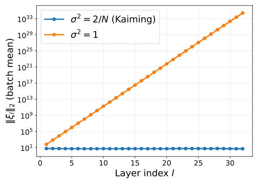
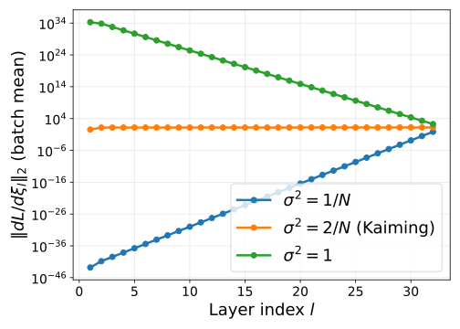
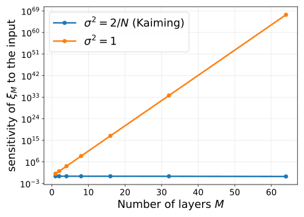
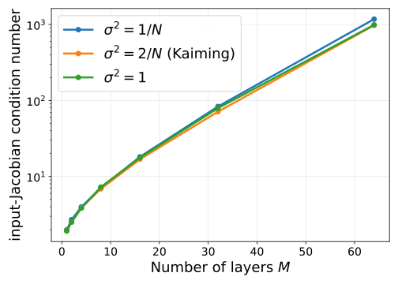
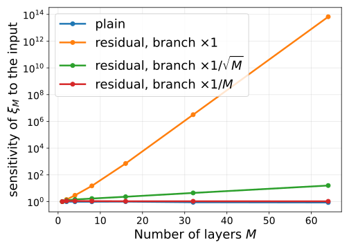
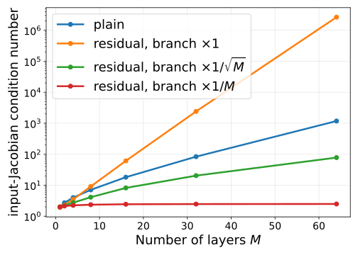

# Signal and Gradient Propagation in a Randomly Initialized MLP

Script: `spbunn/scripts/hidden_norms_propagation.py` · Config: `config/config_hidden_norms.yaml`
Run: `~/venvs/spbu_nn/bin/python -m spbunn.scripts.hidden_norms_propagation`

## 1. Setup

We study a fully-connected MLP with $L$ hidden layers of width $N$, zero biases, and
weights sampled independently $W_{ij} \sim \mathcal{N}(0, \sigma^2)$. Every hidden block is

$$\xi_l = \mathrm{ReLU}(W_l\, \xi_{l-1}), \qquad l = 1, \dots, L,$$

with $\xi_0 = x \in \mathbb{R}^d$ the input. We record what happens in a **single forward and
backward pass at initialization** — no training. All experiments use `float64` (the exploding
regimes overflow `float32` at moderate depths) and average over several random
initializations (seeds), plotting mean $\pm$ std bands.

**Random inputs and random labels.** Inputs are iid $x_i \sim \mathcal{N}(0, 1)$,
$d = 16$, batch 256. The backward pass is probed with an isotropic random output gradient
$g \sim \mathcal{N}(0, I)$, which is equivalent to fitting independent random labels:
at initialization $f(x) \approx 0$, so the initial error $\delta = y - f(x) \approx y$ is
itself isotropic noise. The point: the backward norms then measure the *Jacobian chain
itself*, not a particular target function. For a structured target the initial error could
accidentally be small or aligned with a particular direction of the Jacobian, confounding
the depth dependence we want to isolate. This is the standard probe of the signal
propagation literature (Poole et al. 2016, Schoenholz et al. 2017). Since inputs are
distributional, nothing restricts us to $d = 1$: with $d > 1$ the batch is isotropic from
layer 0 on.

**Theory (zero-mean approximation).** For ReLU with zero biases, the pre-activations are
approximately zero-mean Gaussian, and

$$\mathbb{E}\|\xi_l\|^2 \;=\; d\,\Big(\frac{N\sigma^2}{2}\Big)^{l}, 
\qquad 
\mathbb{E}\left\|\frac{\partial \mathcal{L}}{\partial \xi_l}\right\|^2 \;=\; 
N\,\Big(\frac{\sigma^2 (N+1)}{2}\Big)^{L-l+1}
\quad (l \ge 2),$$

up to corrections. The *forward* per-layer factor is $q = N\sigma^2/2$ (exactly, in
expectation); the *backward* factor carries the $+1$ finite-width correction from the
weight-gradient term. Note the backward signal compounds over the **remaining** layers
$(L - l)$, hence its much steeper depth dependence than the forward curve. The Kaiming
scale

$$\sigma^2 = \frac{2}{N} \quad\Longleftrightarrow\quad q = 1$$

makes the forward factor exactly $1$: the critical initialization. These closed forms are
**zero-mean approximations**: ReLU outputs have positive means, and near criticality the
accumulated mean shift moves the empirical fixed point slightly above the prediction
(forward curves settle a bit above $\sqrt{d}$ instead of exactly $\sqrt{d}$). In the
decay/explode regimes the theory matches over many orders of magnitude regardless.

Defaults below: $N = 256$, $d = 16$, batch 256, 5 seeds, ReLU.

## 2. Experiment 1: forward and backward norms vs the initialization scale

Fix the number of layers $M = L = 32$ and compare two initializations (figures above):

- **Kaiming, $\sigma = \sqrt{2/N}$** (per-layer factor $q = N\sigma^2/2 = 1$, critical):
  both curves stay $O(1)$ for all 32 layers — the network sits at the edge of chaos.
- **Unscaled, $\sigma = 1$, i.e. $W_{ij} \sim \mathcal{N}(0, 1)$** ($q = N\sigma^2/2 = 128$):
  both curves explode exponentially — $\|\xi_l\|$ reaches $\sim 10^{34}$ by layer 32, and the
  gradients explode correspondingly in the backward pass.

The dashed zero-mean theory lines track the measurements over more than 30 orders of
magnitude. The two regimes bracket the teaching point: everything is decided by whether
the per-layer factor $q$ is below, at, or above $1$, and the critical choice is exactly
Kaiming's $\sigma^2 = 2/N$.

One subtlety visible in the backward panel: at $l = 1$ the gradient contracts from $N$
dimensions into the $d$-dimensional input space, replacing the last factor by
$\sigma^2 d / 2$ — hence the characteristic dip of the first point of the theory line.

## 3. Experiment 2: conditioning of the input–output map vs depth

Here we ask not *how large* the signal is, but *how well-conditioned* the map from input
to the last hidden layer is. In this section the number of layers is denoted $M$
(as in the figures below). **Design.** For each of 16 random inputs $x$ we compute:

1. *Empirical sensitivity* (the finite-difference probe): sample random directions
   $\|dx\| = 10^{-3}$ and measure
   $$S(x, dx) = \frac{\|f(x + dx) - f(x)\|_2}{\|dx\|_2},$$
   averaged over directions and inputs.
2. *The exact input Jacobian* $J = \partial \xi_M / \partial x \in \mathbb{R}^{N \times d}$
   via autograd, and its singular values $\sigma_{\max} \ge \dots \ge \sigma_{\min}$:
   the condition number $\kappa = \sigma_{\max}/\sigma_{\min}$ and the Frobenius norm
   $\|J\|_F$ (which equals the RMS sensitivity over all directions).

### 3.1 Plain MLP, Kaiming vs unscaled initialization

Two cases, plain network (figure above):

- **Kaiming (green).** The average sensitivity is flat at $\approx 1$ for all $M$ — the
  same criticality as in Experiment 1. But the spectrum spreads exponentially:
  $$\sigma_{\max}: 1.3 \to 3.2, \qquad 
  \sigma_{\min}: 0.67 \to 3.1\times 10^{-3}, \qquad 
  \kappa: 2 \to 9.9 \times 10^{2} \quad (M = 1 \to 64).$$
- **Unscaled, $\sigma = 1$ (red).** Sensitivity explodes astronomically
  ($\sim 10^{68}$ by $M = 64$ — each layer multiplies the gain by $\approx 11$), while
  its condition number grows almost exactly like the Kaiming case
  ($2 \to 1.2\times 10^3$): the condition number is a *ratio* of singular values and is
  largely invariant to the overall gain.

**The teaching point of the green curves:** a product of many random matrices has
singular values spanning an exponentially wide range even when the typical gain is $1$.
The map becomes hypersensitive to a few input directions and nearly blind to most — this
anisotropy (not the average norm) is the mechanism behind shattered gradients.
**Ill-conditioning hides from averages and shows up in the spectrum.**

### 3.2 Do residual connections fix it?

We add skip connections, $\xi_l = \xi_{l-1} + s\cdot \mathrm{ReLU}(W_l \xi_{l-1})$ (the first,
$d \to N$ block stays plain, as the ResNet stem does), and rerun the experiment at the
Kaiming scale for three choices of the branch scale $s$ (figure above, all four curves):

| variant | sensitivity $\|dy/dx\|$ ($M=1 \to 64$) | $\kappa$ ($M=1 \to 64$) | verdict |
|---|---|---|---|
| plain | $1.0 \to 0.86$ | $2 \to 1.2\times 10^{3}$ | ill-conditioned |
| $s = 1$ (naive) | $1.0 \to 1.3\times 10^{13}$ | $2 \to 2.6\times 10^{6}$ | **explodes** |
| $s = 1/\sqrt{M}$ (ResNet-style) | $1.0 \to 16$ | $2 \to 78$ | mild drift |
| $s = 1/M$ | $1.0 \to 1.05$ | $2 \to 2.5$ | **fixed** |

The intuition, block by block: with a skip, the block Jacobian is
$I + s \cdot \mathrm{diag}(\text{mask})\, W$, whose variance gain is roughly
$1 + s^2 N\sigma^2/2$. So:

- **$s = 1$ multiplies the signal variance by $1.5$ per block** — skip connections alone
  do *not* stabilize anything; they make a Kaiming-initialized network explode.
- **$s = 1/\sqrt{M}$** is the standard pre-activation ResNet initialization; it slows the
  drift but does not eliminate it.
- **$s = 1/M$** makes every block a vanishing perturbation of the identity, so the whole
  map is near-isometric for any depth — perfect conditioning by construction. The price:
  at initialization the network is close to the identity map (the "ResNets at init are
  almost the identity" observation of Balduzzi et al. 2017), i.e. the blocks barely
  contribute; training dynamics may prefer the $1/\sqrt{M}$ trade-off.

**Takeaway:** residual connections fix ill-conditioning *only* when the branch is scaled
so that blocks are perturbative ($s \propto 1/M$); naive skip connections at the Kaiming
scale make things worse.

## 4. Reproducing

All experiment parameters live in `config/config_hidden_norms.yaml`
(`input_dim`, `hidden_dim`, `depth_grid`, `weight_scale`, init-sweep scales,
conditioning counts; `experiments:` selects which of the experiments to run). The
conditioning experiment is the slow one (~20 min: $6$ variants $\times$ 7 depths $\times$
5 seeds of full-Jacobian SVDs).

Figures are saved as `.svg` (repo convention) and `.png` (messenger-friendly) in the
working directory; the PNG copies embedded here live in `notes/`.

## References

- Poole, B., Sohl-Dickstein, J., Ganguli, S. (2016). *Exponential expressivity in deep
  neural networks through transient chaos.* — random-label probe, mean-field propagation.
- Schoenholz, S. et al. (2017). *Deep Information Propagation.* — critical initialization
  for signal/gradients.
- He, K. et al. (2015). *Delving Deep into Rectifiers* — the $\sigma^2 = 2/N$ scaling.
- Balduzzi, D. et al. (2017). *The Shattered Gradients Problem.* — anisotropy of the
  input-Jacobian and residual connections. (The repo's `balduzzi_analysis.py` references
  a `spbunn.resnet` module that does not currently exist in the repo.)
